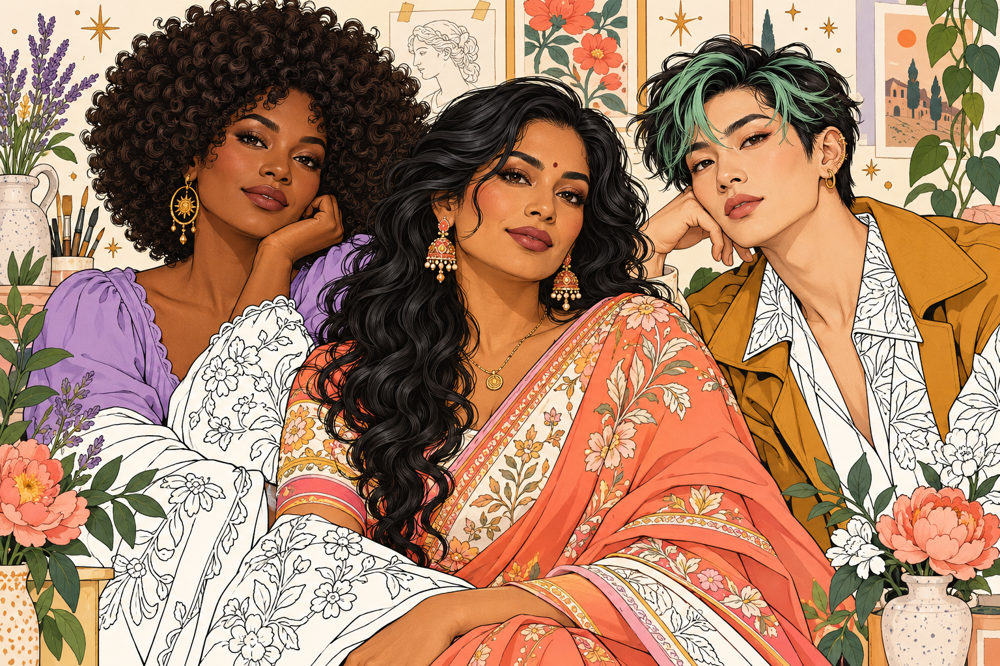

# Musemallow

**A little color. A little calm.** An offline Android coloring studio devoted to adult people: faces, hair, personal style, and expressive figures. Warm cream, strawberry pink, lavender, mint, chunky controls, and a generous canvas give the app its own identity.



## Install the Android app

Download [musemallow-debug.apk](artifacts/musemallow-debug.apk) on an Android phone or tablet, allow installation from the app used to open the download, and install. This is a signed **development/test APK**, not a Play Store release. Android 6.0/API 23 or newer is required; keep Android System WebView updated. The package ID is `studio.musemallow.coloring`.

Verify a downloaded build with:

```sh
sha256sum -c artifacts/musemallow-debug.apk.sha256
```

Keep the installed app when updating to a newer APK signed with the same key. Uninstalling the app or clearing its storage deletes local drawings. Release signing requires your own securely retained key; private signing keys are not committed.

## The studio

- **139 bundled original vector illustrations**: ten stylized collections, a detailed realistic artist study, 12 **Portrait Atelier** pages, and six new **Floral Reverie** portraits. Search, collection and difficulty filters, illustration favorites, and Continue Coloring.
- **Colored inspiration:** each Floral Reverie portrait includes a matching original colored PNG. Open Reference while coloring, enlarge it, or keep it beside the canvas. These examples are bundled for offline use and never overwrite your painting.
- **Eight tools:** tap fill, smooth brush, soft airbrush, pencil, textured brush, eraser, eyedropper, and two-color linear gradients. Brush size, opacity, guided/free painting, and a selectable region lock.
- Curated skin, hair, makeup, fabric, pastel, jewel, and monochrome colors, plus a full color picker, HEX entry, recent colors, saved swatches, and custom palettes.
- Two-finger pan and pinch zoom up to 12×, Fit, full-screen canvas, undo/redo, and stylus pressure when exposed by the device. One finger paints; two navigate. Adding a second finger cancels the tentative stroke.
- Editable local autosaves, original vector snapshots retained with each painting, thumbnails stored separately from stroke history, gallery rename/duplicate/favorite/delete, and confirmed reset.
- High-resolution **2304 × 3072 PNG and JPEG** exports through Android’s share sheet. Browser development builds download the image.
- Light, dark, and system themes, reduced-motion support, bundled fonts, and phone/tablet/landscape layouts.

All illustrations are available from the first launch. No account, ads, purchases, tracking SDK, or network request is required to color. The app has no dependency on an earlier coloring application. No earlier source project was present in the supplied repository.

### Painting gestures

Tap a closed shape with Fill. Select Brush or Shade and drag to paint; guided mode clips the stroke to the region where it began. Select a region, then lock it to shade the same shape across separate strokes. Turn guided mode off for free painting. Gradients use your selected color and secondary shade: drag from the light end toward the shadow end. The eraser removes color while retaining original outlines. Use two fingers to navigate without painting. On a desktop, scroll over the canvas to zoom; `Ctrl/Cmd+Z` undoes and `Ctrl/Cmd+Shift+Z` redoes.

## Develop

Stack: TypeScript, Vite, the browser Canvas/Path2D APIs, IndexedDB, and Capacitor 7 with a small Java Android sharing/lifecycle plugin. Canvas input uses logical artwork coordinates; saved data does not depend on a particular screen size. No backend is needed.

Prerequisites: Node.js 22+ (validated on 24), npm, and Chromium for automated browser tests. For Android, JDK 21, Android platform 35/build tools 35.0.0, and the included Gradle wrapper.

```sh
npm ci
npm run dev
npm run build
npm test
```

Playwright defaults to `/usr/bin/chromium`. Set `CHROMIUM_PATH` to another installed Chromium executable when needed. Tests start the Vite server automatically.

### Build Android

On this Linux cloud machine, the tools are installed outside the repository in `/workspace/tools`. To reproduce the tool installation:

```sh
bash scripts/setup-android.sh
npm run android:build
```

`setup-android.sh` downloads the JDK and Android SDK through their official HTTPS sources, verifies artifact checksums, accepts the SDK licenses, and configures Java to use the existing system certificate trust store and proxy where present. It never disables TLS checks. Set `MUSEMALLOW_TOOLS_DIR` to an appropriate writable path on another machine; existing `JAVA_HOME` and `ANDROID_HOME` are respected. The script is for Linux x64; Android Studio is the recommended setup for macOS/Windows.

The build script compiles the web app, syncs bundled assets into Android, runs Gradle, verifies the APK signature, and writes the APK plus SHA-256 checksum under `artifacts/`. For Android Studio, run `npm run android:sync` and open `android/`.

## Source and artwork

- `src/main.ts`, `src/style.css`: library, gallery, editor controls, palettes, themes.
- `src/canvas.ts`: painting, vector region clipping, deterministic stroke replay, gestures, exports.
- `src/storage.ts`: atomic local documents, lightweight gallery records, bounded artwork cache.
- `src/native.ts` and `android/app/src/main/java/studio/musemallow/coloring/`: Android share/back/background integration.
- `public/art/`: bundled catalog, editable JSON regions, SVG previews, and original line art.
- `scripts/generate-art.mjs`: original vector illustration generator; run `npm run art:generate` after intentional source changes.
- [Artwork guide](docs/ARTWORK.md): composition families, closed region rules, difficulty, and adding drawings.
- [Testing notes](docs/TESTING.md): executed checks and device-specific limitations.
- [Screenshots](docs/screenshots/): actual running UI, including phone and tablet views.

Each saved painting includes its original geometry so updating the library does not silently change existing work. Do not reuse an illustration ID for a different drawing. The canvas holds an independent geometry copy; browsing cache eviction cannot invalidate an open drawing. Paint buffers and display density are capped; gallery browsing does not load every painting’s stroke history.

Nunito Sans and Fraunces fonts are bundled with their OFL licenses in `public/fonts/`. The studio banner, Braided Reverie study, 12 Portrait Atelier pages, and six Floral Reverie pairs are original generated illustrations; the main library consists of original vector compositions. [Artist source notes](artwork-sources/README.md) document the study’s conversion into sharp editable vector regions. No external stock illustration is used.

The [Portrait Atelier collection](artwork-sources/portrait-collection/README.md) includes flowing hair, glasses, couture gowns, braids, headbands, and mature expressive faces. It has 2 Easy, 2 Medium, and 8 Hard pages, classified from their actual usable regions. Original PNGs, generation prompts, immutable source hashes, and compiled line-art SVGs are included.

The new [Floral Reverie collection](artwork-sources/floral-reverie/README.md) pairs six original PNG coloring pages with six colored PNG examples: roses and braids, peonies, sunflowers, daisies, magnolias, and irises. The app uses compiled vector outlines and closed coloring regions to keep painting crisp when zoomed. The colored examples load only when requested. Install version 1.2 over the previous app to retain local work.

## Future extensions

Ads, a virtual currency, and premium drawing entitlements are intentionally deferred. Add them behind a separate entitlement/catalog layer without changing existing artwork IDs or rewriting users’ saved documents. The initial release includes no monetization or tracking code.
