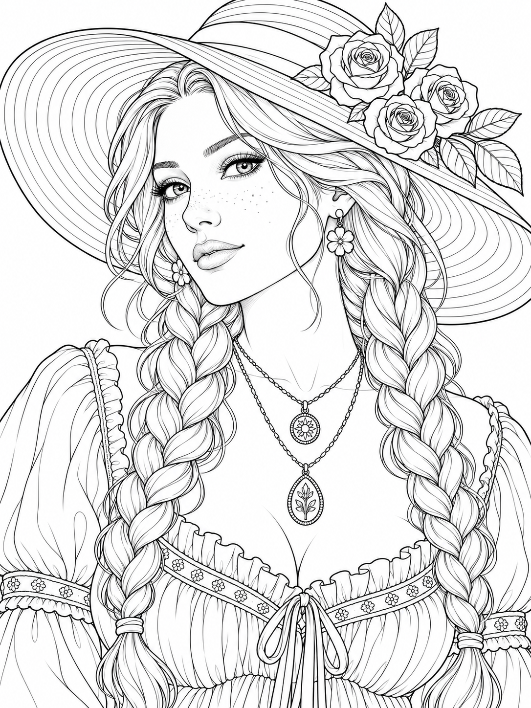
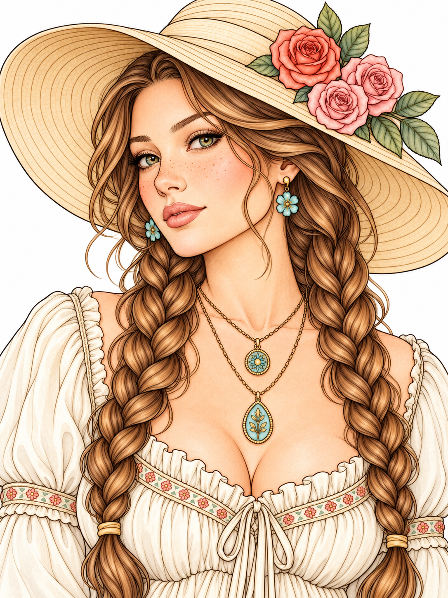

# Dreamlight Portraits

Ten original adult portraits, each supplied as a **1086 × 1448 PNG coloring page** and a matching **colored PNG reference**. Generated for Musemallow on 2026-10-12 with OpenAI image generation. The three supplied references informed the floral hats, braids, butterfly buns, and flowing fashion hair; these are new compositions. Screenshot labels, interface borders, and watermarks are not reproduced.

| Drawing | Original coloring page | Matching inspiration | Coloring regions |
| --- | --- | --- | ---: |
| Rosewood Rambler | [Line PNG](rosewood-rambler-line.png) | [Colored PNG](rosewood-rambler-color.png) | 536 |
| Marigold Muse | [Line PNG](marigold-muse-line.png) | [Colored PNG](marigold-muse-color.png) | 476 |
| Wildflower Poet | [Line PNG](wildflower-poet-line.png) | [Colored PNG](wildflower-poet-color.png) | 401 |
| Butterfly Daydream | [Line PNG](butterfly-daydream-line.png) | [Colored PNG](butterfly-daydream-color.png) | 316 |
| Lilac Orbit | [Line PNG](lilac-orbit-line.png) | [Colored PNG](lilac-orbit-color.png) | 186 |
| Mothlight Velvet | [Line PNG](mothlight-velvet-line.png) | [Colored PNG](mothlight-velvet-color.png) | 292 |
| Rose Quartz | [Line PNG](rose-quartz-line.png) | [Colored PNG](rose-quartz-color.png) | 197 |
| Silver Serenade | [Line PNG](silver-serenade-line.png) | [Colored PNG](silver-serenade-color.png) | 217 |
| Midnight Satin | [Line PNG](midnight-satin-line.png) | [Colored PNG](midnight-satin-color.png) | 245 |
| Camellia Reverie | [Line PNG](camellia-reverie-line.png) | [Colored PNG](camellia-reverie-color.png) | 408 |

 

## Color in the app

Choose **Dreamlight Portraits** in the library. All ten drawings open uncolored and work offline. Tap **Reference** to view the matching colored example; **Keep beside canvas** pins it beside your work. The image is loaded only on request and stays separate from painting commands and exports.

The collection includes floral wide-brim hats, twin and rope braids, a mature portrait with glasses, butterfly space buns, braided buns, an androgynous moth-inspired editorial portrait, pink flowing hair, silver hair and a cape, cascading curls, and a camellia-adorned braided crown. Skin, hair, clothing, jewelry, and expression were reviewed on every source and colored pair. There are no hands in these compositions.

All ten are **Hard**, with 186–536 usable regions each and **3,274 regions** in total. This reflects actual detail rather than a marketing label; the existing Easy and Medium drawings remain available. Zoom in for fine hair, petals, and jewelry. The PNG originals are preserved byte-for-byte. Runtime vector ink and closed regions keep outlines crisp during pinch zoom and allow fill, region-locked shading, and gradients. The logical canvas is 768 × 1024; exports are 2304 × 3072.

## Sources and review

- `manifest.json`: complete image-generation and colored-edit prompts, filenames, permanent IDs, tags, and reviewed contour guides.
- `compilation-report.json`: source hashes, matching color hashes, dimensions, coordinate transforms, and final region counts.
- `boundary-review.json`: fixed reviewed points on the source PNGs for skin, lips, several hair areas, accessories, clothing, background, and botanical details where present.
- `../../public/references/`: unchanged copies of the ten colored originals used by the offline viewer.

Some generated lip outlines and hairline tips were too faint to enclose a region. Explicit two-pixel vector guides follow those reviewed contours and close their gaps in the editable model. Fine source ink and both original PNGs are preserved. Visual diagnostic fills and automated source-hash-bound probes verify separation at the reviewed locations; they are not a claim that every decorative detail has a separate region. Very tiny ink details remain visible even when too small to be useful fill targets.

Colored examples are artistic inspiration with shading, not a required palette or an exact pixel-level coloring solution. Anatomy, accessories, layout, and major contours were compared with their corresponding line originals.

## Rebuild or add another pair

Follow the [portrait compiler guide](../../docs/PORTRAIT-COMPILER.md) for the optional pinned OpenCV/NumPy development environment, then run:

```sh
/tmp/musemallow-art-tools/bin/python scripts/compile-portrait-collection.py \
  artwork-sources/dreamlight-portraits/manifest.json \
  --update-catalogs \
  --report artwork-sources/dreamlight-portraits/compilation-report.json
npm test -- tests/dreamlight-collection.spec.ts
```

Generate a new original adult coloring PNG, inspect it at full resolution, then generate its colored edit using that exact source. Keep both originals and both prompts. Use a new permanent ID, copy the colored PNG to `public/references/<id>.png`, and set `referenceImage` in the manifest. Compile the line PNG, review material boundaries with visible fills, record fixed source-coordinate probes, and test painting and reference loading before publication. Never replace released geometry under an existing ID.

All 139 previous drawings and the six previously released colored references remain byte-identical. Saved paintings keep their original geometry snapshots. Version 1.3 uses the same application ID and retained test signing key, with versionCode 4.
