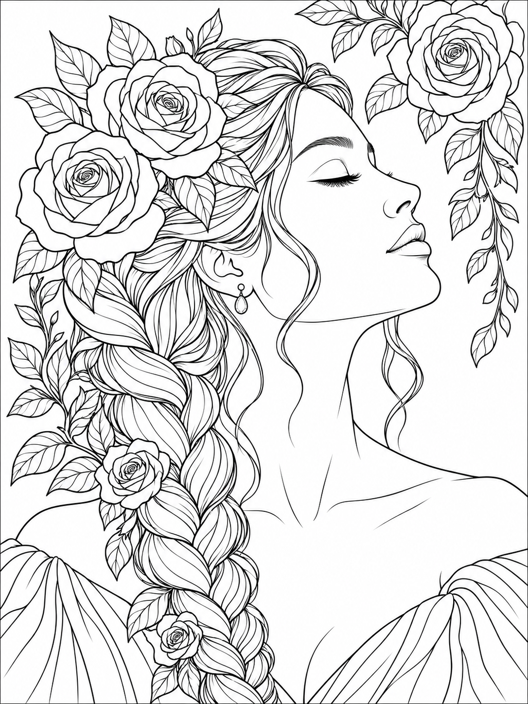
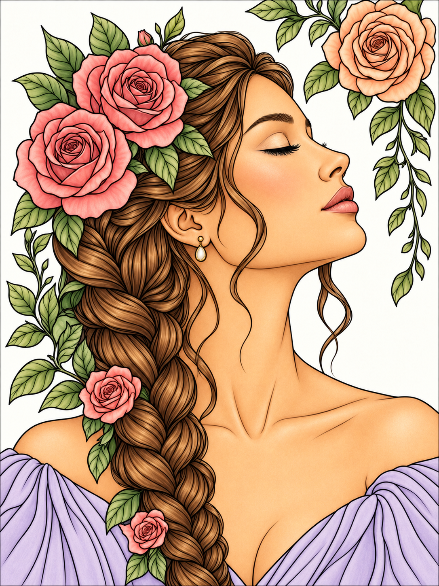

# Floral Reverie

Six original floral portraits for Musemallow, each with a black-and-white coloring PNG and a matching colored PNG example. All twelve images were generated for this project at **1086 × 1448**. The colored versions were created by editing their corresponding line-art sources with instructions to preserve the composition, face, flowers, hair, and clothing.

The supplied references informed the botanical portrait direction: generous flowers framing adult faces, expressive hair, soft expressions, and detailed petals. These are new compositions, with no screenshot borders, interface labels, or watermarks copied from the references.

| Drawing | Original coloring PNG | Colored example PNG |
| --- | --- | --- |
| Rose Ascent — roses, profile, long braid | [Line art](rose-ascent-line.png) | [Colored reference](rose-ascent-color.png) |
| Peony Daydream — flowing waves and peonies | [Line art](peony-daydream-line.png) | [Colored reference](peony-daydream-color.png) |
| Sunflower Stillness — sunflower crown and curls | [Line art](sunflower-stillness-line.png) | [Colored reference](sunflower-stillness-color.png) |
| Daisy Light — mature face and broad floral shapes | [Line art](daisy-light-line.png) | [Colored reference](daisy-light-color.png) |
| Magnolia Poise — smooth bob and magnolias | [Line art](magnolia-poise-line.png) | [Colored reference](magnolia-poise-color.png) |
| Iris Reverie — mature bearded portrait and irises | [Line art](iris-reverie-line.png) | [Colored reference](iris-reverie-color.png) |

 

## In the app

Choose **Floral Reverie** in the library. Each page opens uncolored. Tap **Reference** above the canvas to see its colored example, then choose **Keep beside canvas** to paint while referring to it. The small panel can move to either side, enlarge, or close. The six references are bundled offline and load only when opened. Reference images never become paint commands or appear in exported work.

These PNGs are retained unchanged as source assets. The app compiles the line art into fine vector ink and closed, independently selectable regions for sharp zooming and guided painting. The logical canvas is 768 × 1024, with the source aspect ratio preserved; PNG/JPEG exports are 2304 × 3072. Final difficulty and region counts are recorded in `compilation-report.json` and computed from usable regions using the same rules as the existing library.

The six pages have **2,166 usable regions** in total: Rose Ascent 619, Peony Daydream 234, Sunflower Stillness 622, Daisy Light 62, Magnolia Poise 253, and Iris Reverie 376. All classify **Hard** under the existing threshold of 60 regions. Daisy Light has broader shapes, though its individual flower and facial cells still contribute to that count. Easy and Medium pages remain available elsewhere in the library.

## Provenance and review

- `manifest.json` retains the original generation/edit prompts, source filenames, tags, and reviewed compiler settings.
- `compilation-report.json` records source hashes, geometry counts, and coordinate transforms.
- `boundary-review.json` records manually reviewed source-coordinate samples for skin, hair, lips, petals, leaves, clothing, and background, paired with source hashes.
- `public/references/` contains byte-identical copies of the colored source PNGs. The optional catalog `referenceImage` points to the matching copy.

The portraits were reviewed for adult facial proportions, eyes, ears, necks, hair, clothing, and flower placement; these compositions have no hands. Each colored pair was compared visually for composition correspondence. Generated coloring examples include artistic shading and are inspiration, not a required palette or a pixel-perfect coloring solution.

Small source contour gaps are closed using explicit reviewed vector boundary guides where necessary. These affect the coloring-region model while preserving the source PNG and fine ink. No blanket image retouching is used. Fixed semantic probes verify that skin does not leak into sampled hair, lips, petals, leaves, clothing, or background. Brush and gradient tests also check actual rendered pixels.

## Reproduce or extend

Use the [portrait compiler guide](../../docs/PORTRAIT-COMPILER.md) to install the optional OpenCV/NumPy development tools. The app itself does not need them.

```sh
/tmp/musemallow-art-tools/bin/python scripts/compile-portrait-collection.py \
  artwork-sources/floral-reverie/manifest.json \
  --report artwork-sources/floral-reverie/compilation-report.json \
  --update-catalogs
npm test -- tests/floral-collection.spec.ts tests/references.spec.ts
```

To add another pair, generate a clean adult coloring PNG, inspect it, then generate a colored edit using that exact source image. Keep both originals and prompts. Choose a new permanent drawing ID, add the line source to the manifest, copy the colored PNG unchanged to `public/references/<id>.png`, and set `referenceImage` to `/references/<id>.png`. Compile and visually review skin/hair/floral boundaries before publishing. Add fixed semantic probes and test actual filling, shading, gradients, reference loading, and reopening saved work.

The original 133 drawings are retained unchanged. Never replace released geometry or reference compositions under an existing ID; use a new versioned ID. Saved paintings also retain their original vector snapshots.
